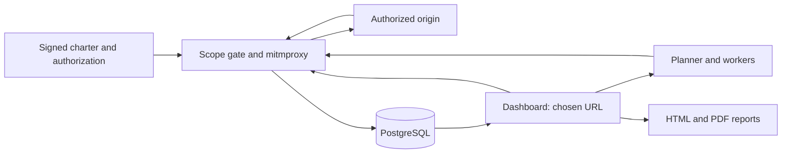

# Charter

Charter is an operator console for authorized security tests. You choose the target URL, capture one exchange, or start an autonomous campaign. A signed charter is checked again before every request. The bundled Juice Shop lab is the default local target, not the only one.

## Demo

In this recorded engagement, the signed worker captured one landing-page response and the proxy blocked a second request. The downloadable HTML includes the complete HTTP message bodies. The PDF summarizes the finding, scope, evidence and remediation.

- [Watch the 17-second dashboard walkthrough](https://raw.githubusercontent.com/AnthonyElDebs/charter/main/demo/sample/demo.webm)
- [Read the sample PDF](demo/sample/engagement.pdf)
- [Download the self-contained HTML report](https://github.com/AnthonyElDebs/charter/raw/refs/heads/main/demo/sample/engagement.html)
- [Inspect the successful run that generated these artifacts](https://github.com/AnthonyElDebs/charter/actions/runs/44417398989)

## Run the console

Install Docker Engine with Compose v2, Python 3.11 or newer, and OpenSSH with `ssh-keygen -Y` support. The host approval command uses only the Python standard library. On Windows, you can substitute `py -3` for `python`.

Approve the bundled lab, then open the dashboard at [http://127.0.0.1:8000](http://127.0.0.1:8000). Type the URL you want to test, then choose **Capture this URL** or **Run autonomous test**.

```sh
python lab.py --operator local-operator --approve-local-lab
docker compose --env-file private/compose.env up --build --wait -d
```

The same page can target any origin named by the signed charter. The public Zero Bank demo is one example:

```sh
python lab.py --operator local-operator --target http://zero.webappsecurity.com/ --approve-target
```

Put the model settings in `private/compose.env`. That file is gitignored. Do not pass the key on the command line and do not commit it.

```sh
CHARTER_LLM_BASE_URL=https://api.anthropic.com
CHARTER_LLM_API=anthropic
CHARTER_LLM_API_KEY=
CHARTER_LLM_MODEL=claude-sonnet-4-5
```

Ollama works without a key. Set `CHARTER_LLM_API=ollama` and a base URL the planner container can reach. For a planner on the host, the capture proxy is published on `127.0.0.1:8080` and Postgres on `127.0.0.1:5432`.

```sh
docker compose --env-file private/compose.env --profile run run --rm planner --goal "Prove a broken access-control or injection issue on the authorized target." --url http://zero.webappsecurity.com/
```

The one-request worker is still available. With no `--url` it uses the charter's first allow rule.

```sh
docker compose --env-file private/compose.env run --rm worker
docker compose --env-file private/compose.env run --rm worker python -m app.worker --url http://zero.webappsecurity.com/
docker compose --env-file private/compose.env run --rm worker python -m app.worker --check-denial
```

`--check-denial` sends the charter's first deny rule. The bundled lab denies `http://juice-shop:3000/private`. A custom origin has no deny rule unless you add one, so the denial check belongs to the lab charter. You can also browse the [local Juice Shop](http://127.0.0.1:3000). Browser activity on port 3000 is outside the capture path.

Outside lab mode, the dashboard shows each proposed step with Approve and Deny. Lab mode, and the **unattended** checkbox, skip that queue. The charter is still enforced on every URL.

## Verify the demo

```sh
python tests/smoke.py --export private/reports
```

The smoke test requests a fresh capture, exercises the denied path, verifies both body digests from PostgreSQL-backed API records, checks the dashboard, and downloads both report formats. Generated engagement files live under `private/`.

To stop the lab while retaining its database volume:

```sh
docker compose --env-file private/compose.env down
```

Rerun the approval command after expiry. Each approval creates a versioned bundle. Keep the private key and database password on the operator's machine. Removing `private/approved/current` revokes the active approval for subsequent requests.

## Architecture



The [design and operating notes](docs/architecture.md) describe the trust boundary, evidence format, network layout and local tests. Phase 1 records one signed exchange. The campaign plans the next step, sends it through the same proxy, writes the finding back, and plans again until the goal is proven or a budget runs out.
