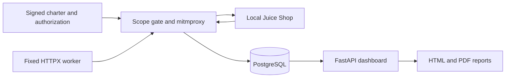

# Charter

Charter captures one authorized HTTP exchange from a local OWASP Juice Shop lab and turns it into an evidence-backed security report. A signed charter and its written authorization must pass verification before the proxy forwards a request.

## Demo

In this recorded engagement, the signed worker captured one landing-page response and the proxy blocked a second request. The downloadable HTML includes the complete HTTP message bodies. The PDF summarizes the finding, scope, evidence and remediation.

- [Watch the 17-second dashboard walkthrough](https://raw.githubusercontent.com/AnthonyElDebs/charter/main/demo/sample/demo.webm)
- [Read the sample PDF](demo/sample/engagement.pdf)
- [Download the self-contained HTML report](https://github.com/AnthonyElDebs/charter/raw/refs/heads/main/demo/sample/engagement.html)
- [Inspect the successful run that generated these artifacts](https://github.com/AnthonyElDebs/charter/actions/runs/44417398989)

## Run the lab

Install Docker Engine with Compose v2, Python 3.11 or newer, and OpenSSH with `ssh-keygen -Y` support. The host approval command uses only the Python standard library. On Windows, you can substitute `py -3` for `python`.

From the repository root, approve a one-hour engagement for a lab you control. Replace `local-operator` with your operator ID.

```sh
python lab.py --operator local-operator --approve-local-lab
docker compose --env-file private/compose.env up --build --wait -d
docker compose --env-file private/compose.env run --rm worker
docker compose --env-file private/compose.env run --rm worker python -m app.worker --check-denial
```

Open the [dashboard](http://127.0.0.1:8000) and select the completed run. Inspect the captured HTTP headers and body, then download the HTML or PDF report. The separate blocked run records the signed deny rule in the audit log. You can also browse the [local Juice Shop](http://127.0.0.1:3000). Browser activity on port 3000 is outside the worker capture path.

The worker issues one anonymous GET and disables redirects. Its header check reports a missing Content-Security-Policy response header on an HTML 200 response. A complete run can legitimately contain zero findings. The packaged lab and operator UI are intended for one trusted local user.

## Verify the demo

```sh
python tests/smoke.py --export private/reports
```

The smoke test requests a fresh capture, exercises the denied path, verifies both body digests from PostgreSQL-backed API records, checks the dashboard, and downloads both report formats. Generated engagement files live under `private/`.

To stop the lab while retaining its database volume:

```sh
docker compose --env-file private/compose.env down
```

Rerun the approval command after expiry. Each approval creates a versioned bundle. Keep the private key and database password on the operator's machine. Removing `private/approved/current` revokes the active approval for subsequent requests.

## Architecture



The [design and operating notes](docs/architecture.md) describe the trust boundary, evidence format, network layout and local tests. The project implements the charter, evidence, reporting, dashboard and portfolio phases. The worker is deterministic and requires no model API key.
